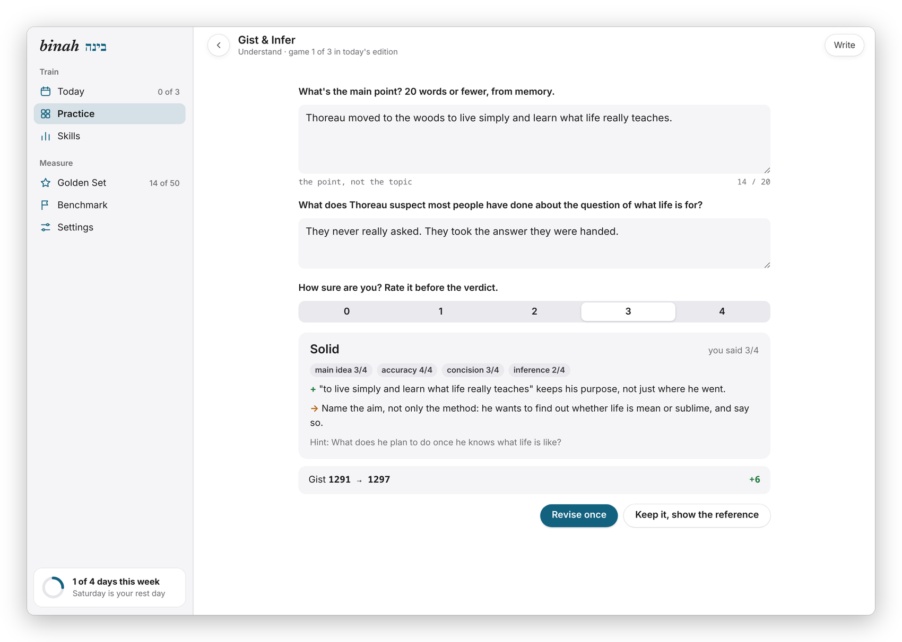
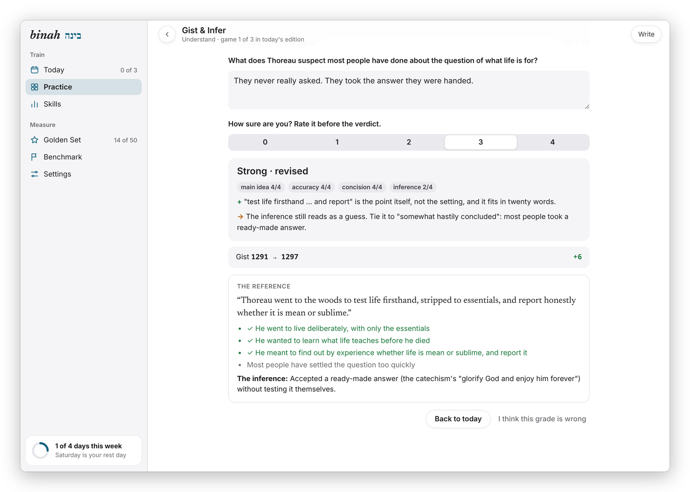
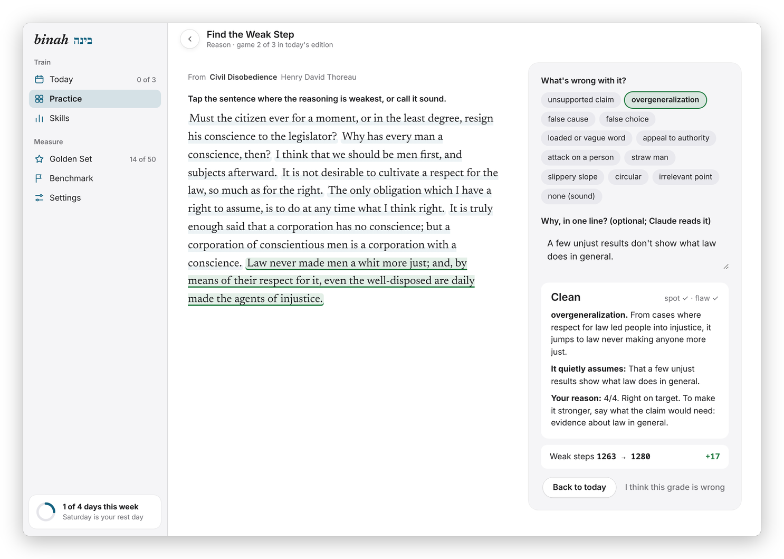
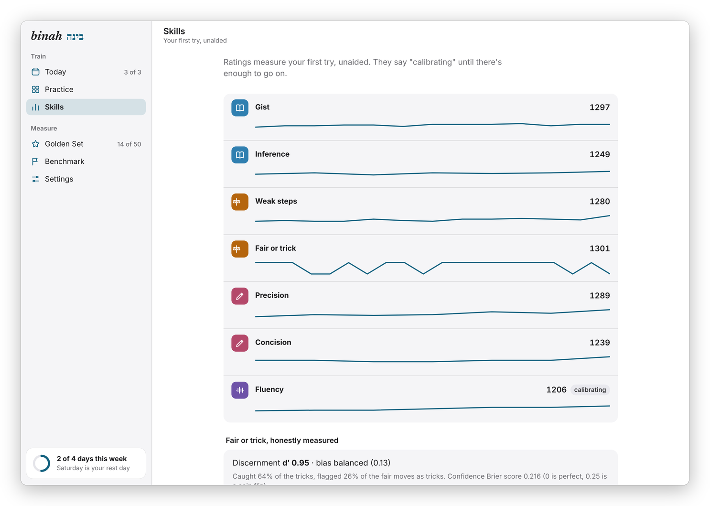
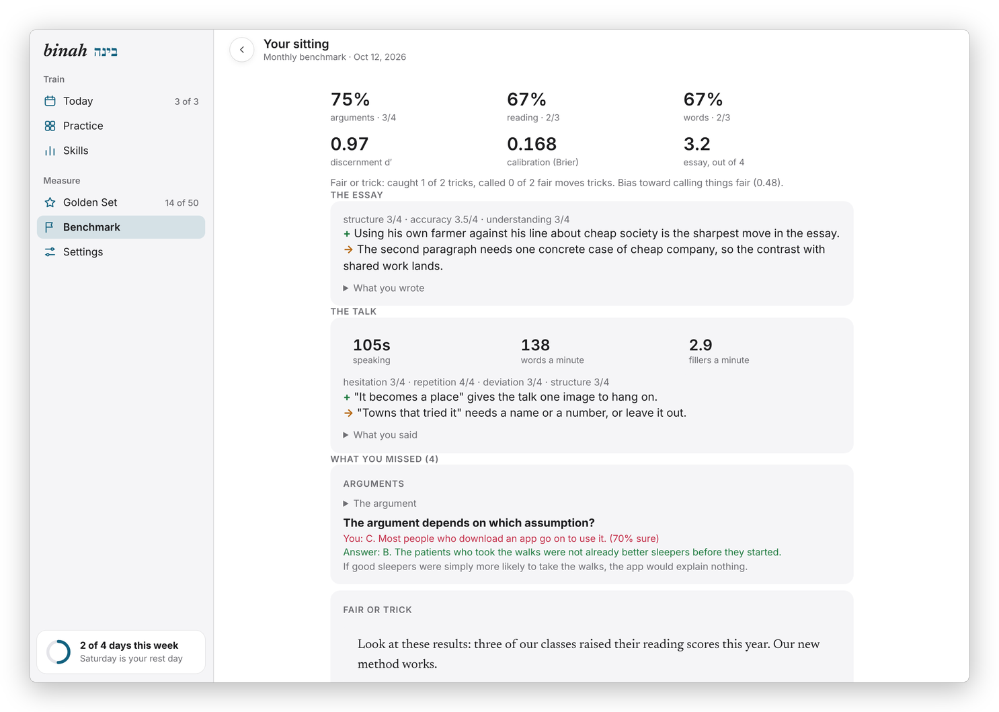
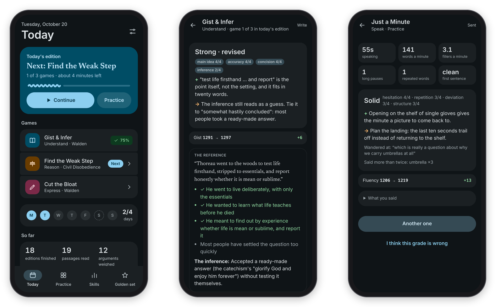
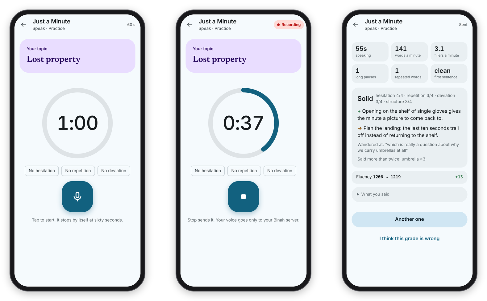
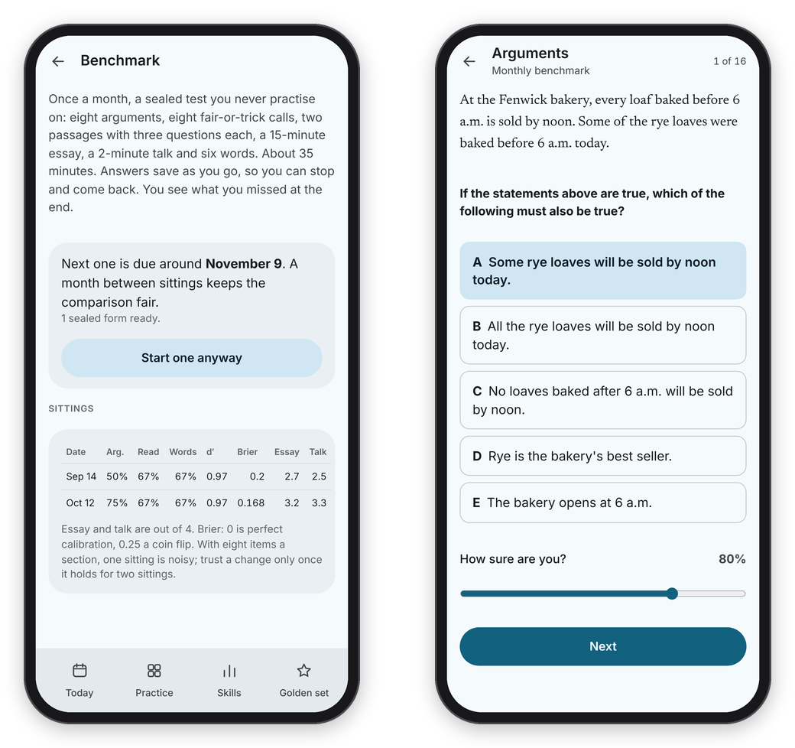
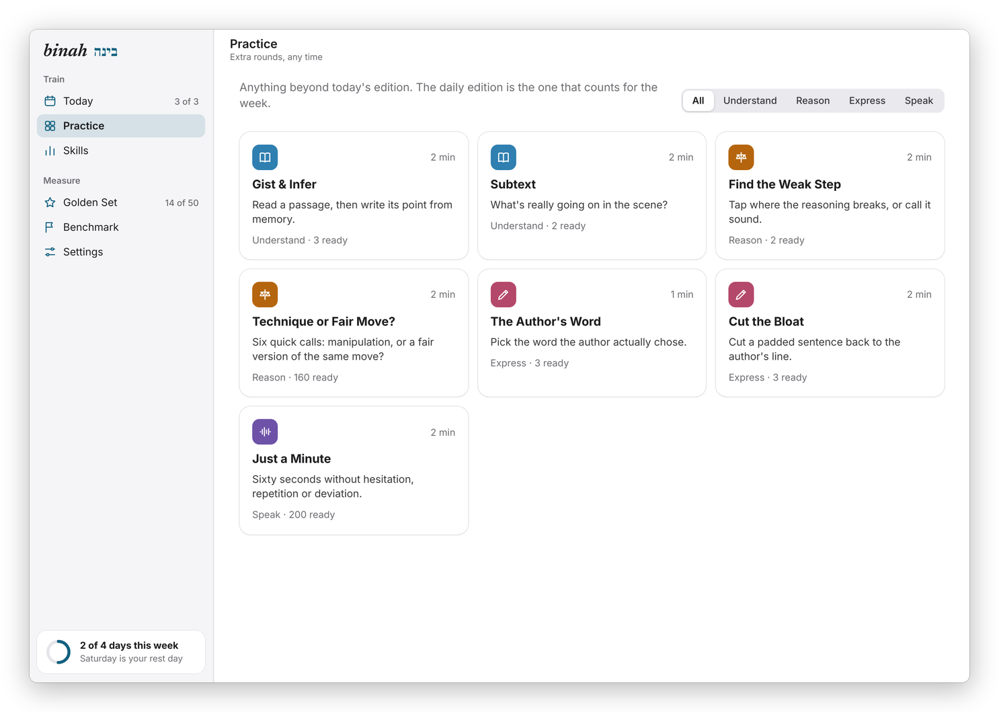

  

<h1 align="center">Binah</h1>

<b>A few minutes a day of training in reading closely, weighing arguments and saying what you mean.</b> Real text, an honest grade, one revision, and only then the answer.

  
  
  
  
  
  

  <a href="docs/README.md"><b>Docs</b></a> ·
  <a href="#install">Install</a> ·
  <a href="#features">Features</a> ·
  <a href="#screenshots">Screenshots</a> ·
  <a href="https://stuffs.tiresia.xyz/binah/">Try one game</a> ·
  <a href="docs/why-i-made-it.md">Why I made it</a>

<picture>
  <source media="(prefers-color-scheme: dark)" srcset="docs/images/hero-dark.png">
  
</picture>

## Why I built it

Binah (בינה) is the Hebrew word for understanding, which is basically the whole point. It's my daily training app for understanding what I read, weighing what I hear, and saying what I mean. It's a phone-first web app with Mac and Android apps around it, it runs on my own server behind a login, and the code is here in case it's useful to someone else.

I started out wanting a Lumosity for language, and the research talked me out of it. Brain games make you better at brain games and not much else, so every game in Binah is a small, honest slice of the REAL skill, done on real text: I summarize an actual passage from memory, I find the actual weak step in an actual argument, I cut a padded sentence back to what a good writer actually wrote, and I talk for an actual minute without hesitating.

The one idea that makes it different is the order inside every answer. I answer and rate myself, Claude reads my answer against a hidden key and gives me one strength and one thing to work on, I get ONE revision, and only then do I see the reference. The research says the learning lives in the revision, so that's where Binah puts it. Code scores everything that can be counted, and Claude only judges what needs judgment.

You can try one of the games, Technique or Fair Move?, at **[stuffs.tiresia.xyz/binah](https://stuffs.tiresia.xyz/binah/)**. That page runs entirely in the browser; its source is `demo/`, and `tools/build_demo.py OUT_DIR` puts it together.

## Features

### The daily edition
- **Five to eight minutes, and then it's done.** A recall card on yesterday's passage, then one game for understanding, one for reasoning, and one for writing or speaking, and then the page says "Today's edition is done."
- **No streak to break.** There's a weekly rhythm instead: I choose how many days a week I aim for, a rest day counts as on track, and the counts on the page only go up.
- **Practice when I want more.** Every game is in Practice for extra rounds, which don't count toward the week.
- **A look that fits the device.** On a computer and in the Mac app it looks like Apple's own apps, with a sidebar and games split into a reading pane and an answer panel. On a phone and in the Android app it follows Material 3, with a big Continue card and a bottom bar.

### Seven games
- **Gist & Infer.** Read a passage, hide it, write its point in 20 words or fewer from memory, and answer one question whose answer is implied but never stated.
- **Subtext.** A scene that's mostly dialogue, and one question: what's really going on?
- **Find the Weak Step.** Tap the sentence where an argument breaks and name the flaw, or call it sound.
- **Technique or Fair Move?** Six quick calls. Half are manipulation and half are the same move done fairly, so it trains judgment, not suspicion.
- **The Author's Word.** One word is blanked out of a good sentence, and I pick the one the author chose out of four or five close ones.
- **Cut the Bloat.** Someone padded a good writer's sentence, and I cut it back, with the author's own word count as par.
- **Just a Minute.** Sixty seconds on a topic without hesitation, repetition or deviation, recorded in the app and transcribed on the server.

### Grades I can check
- **Answer, verdict, revise, reference.** The server holds to that order, not just the screen, and the hidden key is never sent before the answer is in.
- **"Grading later", never a made-up score.** If Claude can't grade an answer, it says so instead of guessing, and once the daily cap is reached, grading waits for the next day.
- **A golden set.** I score answers myself with the same rubric Claude uses, and the app shows how well Claude agrees with me (exact, within one point, leniency, and quadratic weighted kappa).
- **"I think this grade is wrong"** is under every result, and the grades I dispute are listed with the golden set.

### Honest numbers
- **Elo-style ratings** for every skill and every item, from my first try only. Items are picked so I'd be expected to get about 75% right, and a rating says "calibrating" until there's enough to go on.
- **Fair or trick, measured properly.** Discernment (d′) and bias, so getting more suspicious doesn't look like getting sharper, plus a Brier score on how sure I said I was.
- **A monthly benchmark.** A sealed test I never practise on: arguments, fair-or-trick calls, reading questions, words, a 15-minute essay graded twice and a two-minute talk that's transcribed and then graded. It has its own track, apart from practice.

### My own books, kept private
- **A passage engine** that goes through my own ebooks (a Calibre library) for good passages, measures every one with plain, checkable numbers, has Claude draft items from only the best candidates, and has a second model check them blind. Items from your own books stay in your own copy.
- **Train on this.** A link or a passage can be sent from Android's share sheet or the Mac's Services menu. For now Binah only keeps what you send, and the nightly run doesn't turn it into items yet.
- **What I write, as Markdown**, if I want it: one dated file a day in a folder I choose, like an Obsidian vault.

## Screenshots

  

*After the one revision: the second verdict, the rating change, and the reference, with the key points I covered ticked.*

*On a wide window a game splits in two: Thoreau's Civil Disobedience on the left with the weakest sentence underlined, and on the right my answer, the flaw, what it quietly assumes, and a note on my one-line reason.*

*Skills: a rating per skill with its recent trend. Fluency still says "calibrating".*

*A finished benchmark sitting: the scores, the essay's two readings averaged, and the talk.*

More screenshots

*Dark mode follows the system.*

*The edition opens with a recall card on yesterday's passage.*

*Gist & Infer: the answer and a self-rating first, then the verdict.*

*One revision, and then the reference.*

*Technique or Fair Move?: this one looks like outrage but it's a fair move, because the facts warrant it.*

*The Author's Word and Cut the Bloat.*

*A passage to read for Gist & Infer, and Subtext on a scene from Pride and Prejudice.*

*Just a Minute: the topic, the minute running, and the result.*

*The monthly benchmark and a question in a sitting.*

*The golden set: how well Claude's blind grades agree with mine.*

*Practice: extra rounds of any game.*

The screenshots come from a sandbox with public-domain passages (Thoreau, Mill, Emerson, Austen, Lincoln) and made-up history and grades, never my own copy. See [the image credits](docs/images/CREDITS.md).

## Install

### Try one game first
[stuffs.tiresia.xyz/binah](https://stuffs.tiresia.xyz/binah/) has Technique or Fair Move? running entirely in your browser, with no account and no server, so nothing you do there leaves your browser. The rest of Binah needs a server, below.

### On the web
Binah is a web app, so on any phone or computer you open your copy's address and sign in with the username and password set on the server. On a phone, **Add to Home Screen** (Safari) or **Install app** (Chrome) puts it on the home screen, where it opens full screen like an app. Full steps in [Install and devices](docs/install.md).

### Mac
There are no downloads on GitHub Releases, so the Mac app is built from this repository: on macOS 26 or newer with Xcode installed (for `actool`, which compiles the icon), run `cd mac && ./build.sh` and copy `build/Binah.app` to Applications. It's a native SwiftUI app, with every game, Binah's menus, today's edition in the menu bar and Train on This. See [Install → Mac](docs/install.md#the-mac-app).

### Android
The Android app is built from the repository too, with JDK 17 and the Android SDK: `cd android && ./gradlew assembleDebug` makes a test build, and `./release.sh` makes a signed one with your own key. It adds a home-screen widget, Train on this in the share sheet, and the microphone. See [Install → Android](docs/install.md#the-android-app).

### Your own server
You'll need Python 3.12 and the Claude Code CLI logged in on the same machine, because grading runs on your own Claude subscription. A Calibre library is optional, and it's what the reading games are made from. See [Running your own copy](docs/server.md).

## Documentation

Everything past this page is in the [docs](docs/README.md):

- **Getting started:** [What is Binah?](docs/what-is-binah.md), [Why I made it](docs/why-i-made-it.md), [Install and devices](docs/install.md)
- **Using Binah:** [The daily edition](docs/daily-edition.md), [The games](docs/games.md), [Ratings and the golden set](docs/ratings-and-golden-set.md), [The monthly benchmark](docs/benchmark.md), [Speaking](docs/speaking.md)
- **Running your own copy:** [Your own server](docs/server.md)
- **Under the hood:** [Design](docs/DESIGN.md), [The passage engine](docs/ENGINE.md), [Operations](docs/OPERATIONS.md), [The shell contract](docs/SHELL.md), [Developing](docs/DEVELOPING.md)

Start with [What is Binah?](docs/what-is-binah.md)

## How it's built

- **Server:** Python (FastAPI) with SQLite, in one process that also works the grading queue in the background. Everything personal lives in a state folder outside the repo: the database, the login, the settings, and anything mined from your own books.
- **Web app:** vanilla JavaScript with no build step (`web/`), phone first, with a service worker so it opens without a connection. One stylesheet has two looks: Material 3 under 900px wide and in the Android app, and an Apple-like look with a sidebar everywhere else.
- **Grading:** the Claude Code CLI (`claude -p`) on the owner's own subscription, through one small wrapper (`binah/claude_cli.py`), with tools, settings and session history switched off and a daily cap on graded calls.
- **Speech:** faster-whisper on the server's CPU, with voice detection for pauses, and fillers and repeats counted by code. Claude gets the transcript and the numbers, never the audio.
- **Apps:** the Mac app is native SwiftUI and talks to the JSON API ([docs/API.md](docs/API.md)). The Android app is a Java WebView without AndroidX, with the page as its whole interface; [docs/SHELL.md](docs/SHELL.md) is the contract between them. A native Android app in Kotlin and Compose is being built beside it.

## Credits

Binah stands on these, with thanks:

- [FastAPI](https://github.com/fastapi/fastapi) (MIT), [Uvicorn](https://github.com/encode/uvicorn) (BSD-3-Clause) and [python-multipart](https://github.com/Kludex/python-multipart) (Apache-2.0) for the server.
- [faster-whisper](https://github.com/SYSTRAN/faster-whisper) (MIT), with [CTranslate2](https://github.com/OpenNMT/CTranslate2) (MIT), [PyAV](https://github.com/PyAV-Org/PyAV) (BSD-3-Clause), [ONNX Runtime](https://github.com/microsoft/onnxruntime) (MIT), Hugging Face's [tokenizers](https://github.com/huggingface/tokenizers) and [huggingface_hub](https://github.com/huggingface/huggingface_hub) (Apache-2.0) and the [Silero VAD](https://github.com/snakers4/silero-vad) model (MIT), running OpenAI's [Whisper](https://github.com/openai/whisper) small.en model (MIT) for speech.
- [wordfreq](https://github.com/rspeer/wordfreq) (Apache-2.0 code, CC BY-SA 4.0 data) for how rare a word is, in the passage engine.
- The fonts in `web/fonts`, all under the SIL Open Font License 1.1: [Newsreader](https://fonts.google.com/specimen/Newsreader) by Production Type, [Figtree](https://fonts.google.com/specimen/Figtree) by Erik Kennedy, and [Frank Ruhl Libre](https://fonts.google.com/specimen/Frank+Ruhl+Libre) by Yanek Iontef. The icon's ב is drawn from Frank Ruhl Libre.
- The [Gradle Wrapper](https://github.com/gradle/gradle) (Apache-2.0) in `android/`, and [fontTools](https://github.com/fonttools/fonttools) (MIT), [Brotli](https://github.com/google/brotli) (MIT) and [Pillow](https://github.com/python-pillow/Pillow) (MIT-CMU) for `tools/make_icons.py`.
- The monthly benchmark's reading passages come from public-domain essays, downloaded from [Project Gutenberg](https://www.gutenberg.org) on the server.
- The practice content in `content/` (the Technique or Fair Move? items and the Just a Minute and Table Topics prompts) was written for Binah and is under the same MIT license as the code. Grading runs on [Claude](https://www.anthropic.com/claude), through the Claude Code CLI.

The code is MIT, see [LICENSE](LICENSE).
