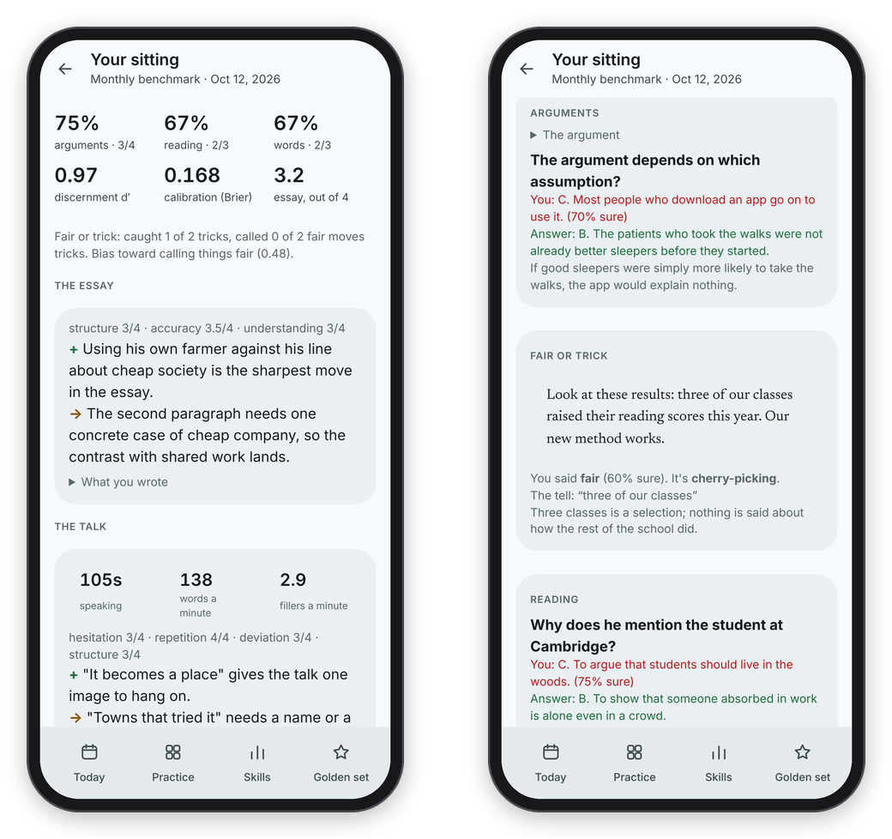

[Binah docs](README.md) › Using Binah

# The monthly benchmark

The monthly benchmark is a sealed test you never practise on, and it's where the honest number comes from. Scores inside the games climb faster than real skill, which is normal, so once a month you sit a fresh form under the same conditions and see what changed. This page covers what's on a form, how a sitting works, and how to read the results.

## What's on a form

A form takes about 35 minutes and has six sections:

- **Arguments**: eight short arguments in the style of a law-school admission test, each with a question (what weakens or strengthens it, what it assumes, where it goes wrong, what follows from it) and five choices.
- **Fair or trick**: eight short texts, half manipulative and half the same move done fairly.
- **Reading**: two passages from public-domain essays, with three questions each.
- **The essay**: 15 minutes on a prompt about the second reading passage.
- **The talk**: two minutes, spoken, on a prompt. "Make one point and support it."
- **Words**: six words in a sentence, and what each one means there.

Every multiple-choice question also asks how sure you are, which gives you a calibration score.

The forms are written on the server, never in the repository, by `python -m binah.benchgen` (see [Your own server](server.md)). Claude drafts each question and a different model answers it blind, and a question is kept only if the two agree on the key. Reading questions also have to fail a no-passage check: shown only the question and its choices, twice and in two different orders, the checker must not find the answer both times, so you can't get it right without reading. Each form is sat once and never comes back.

## When a sitting is due

On a computer, open **Benchmark** in the sidebar, which says **Due** when it's time. On a phone, open **Skills** and press **The monthly benchmark** at the bottom. The overview says whether a sitting is due (28 days after the last one), how many sealed forms are ready, and lists every sitting so far. Before the first one it says "Take the first one to set your baseline." You can start early with **Start one anyway**, though a month between sittings keeps the comparison fair.

I'd sit it two or three times before using Binah every day. That baseline is the only way to tell, later, how much of any gain is just getting used to the test.

*The overview with the sittings so far, and a question in a sitting.*

## A sitting

Press **Start a sitting**. The questions come one at a time, with the section in the header and a counter at the top right ("1 of 30"). Pick an answer, set how sure you are with the slider, and press **Next**. On a keyboard, **1** to **5** or **A** to **E** pick an answer and **Enter** goes on. There's no feedback until the end, on purpose.

Every answer is saved as you give it, so you can stop and come back: the overview then says "You have a sitting in progress" and **Continue it** picks up where you left off.

The essay has a 15-minute timer and saves as you type. Press **I'm done** when you're finished, and when the time runs out it saves what you have and moves on. The talk records for up to two minutes (tap to start, tap to stop early), and if you can't speak right now, **Skip the talk this time**. At the end, "That's everything" asks you to press **Hand it in**.

## Reading the results

The results open straight away: arguments, reading and words as percentages, your discernment d′ for fair or trick, your calibration as a Brier score (0 is perfect, 0.25 is a coin flip), and the essay out of 4. The essay is graded twice by Claude, with a frozen rubric (structure, accuracy, understanding), and the two readings are averaged. If they disagreed by two points or more, it says so, which means take that one loosely. The talk is transcribed on the server and then graded once, with the same numbers as Just a Minute (see [Speaking](speaking.md)). Both take a minute or two to arrive, and the page fills them in by itself.

*A finished sitting: the scores, the essay and the talk, and every miss with its explanation.*

Under "What you missed" is every question you got wrong, with your answer, the right one, and why. That's fine to see, because that form never comes back.

The overview's table keeps every sitting side by side: arguments, reading, words, d′, Brier, essay and talk. With eight items a section, one sitting is noisy, so trust a change only once it holds for two sittings. Practice ratings and benchmark scores are kept on separate tracks and never mixed.

If the overview says no forms are left, write some more on the server with `python -m binah.benchgen --forms 3`. The nightly run also keeps two unused forms in hand, a few calls a night at most.

Next: [Speaking](speaking.md) →
