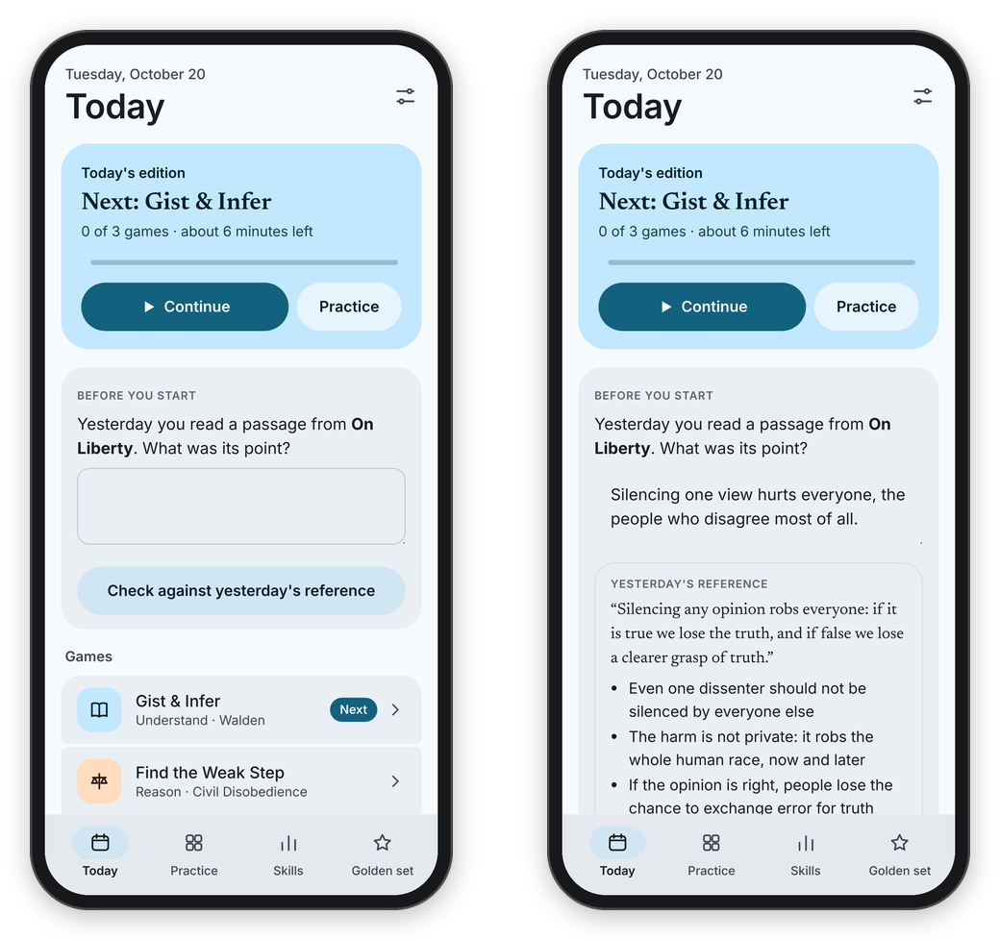
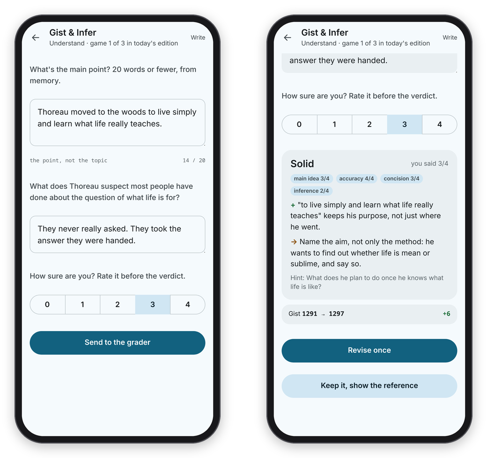
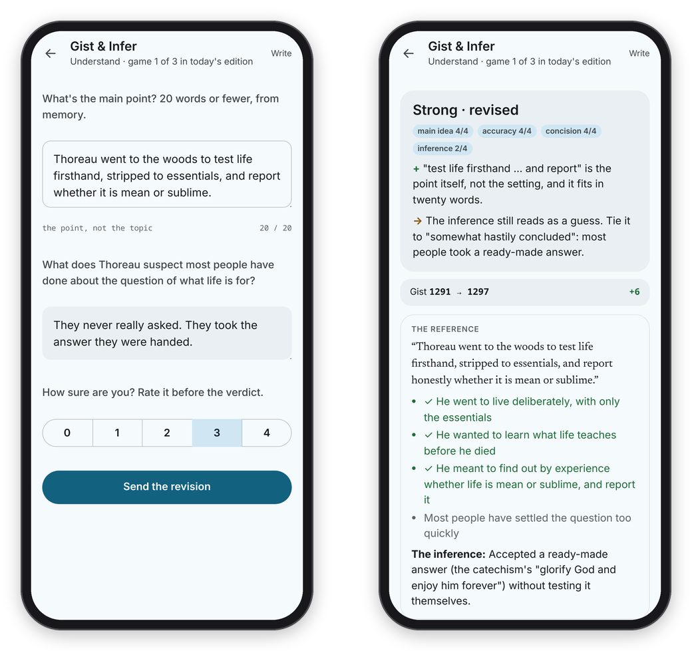

[Binah docs](README.md) › Using Binah

# The daily edition

The daily edition is the heart of Binah: a short, finite set of games that takes about five to eight minutes and then says it's done. This page goes through the Today screen, the recall card, how an open answer runs from your first try to the reference, and how the week is counted.

## The Today screen

**Today** opens with the date and a card for today's edition. On a phone the card says which game is next ("Next: Find the Weak Step"), how many games are done and about how many minutes are left, with a wavy line for your progress, and two buttons, **Continue** and **Practice**. On a computer the card has a ring with the count in it ("1/3") and "Next is …, from …", there's a **Continue** button on it, and **Continue Edition** sits in the toolbar too. **Continue** always opens the next game you haven't done.

Under the card, "Games" lists the edition's three games, each with its pillar's icon, its name, the pillar (Understand, Reason or Express) and where the passage comes from. The next one is marked **Next**, and a game you've finished shows your score with a tick.

*The edition opens with a recall card on yesterday's passage.*

Every edition has the same shape: one game for understanding, one for reasoning, and one for writing or speaking, and the games rotate from day to day. Gist & Infer comes up most days and Subtext every third, Find the Weak Step and Technique or Fair Move? take turns, and The Author's Word, Cut the Bloat and Just a Minute rotate in the last slot. Within a game, Binah picks the item that best fits your rating (see [Ratings and the golden set](ratings-and-golden-set.md)). If a game has nothing to play yet, the edition uses another game from the same pillar, or leaves that slot out.

Below the games, "This week" shows the days of the week, filled in for the days you played, with your rest day drawn as a dashed circle and a count like "2/4 days". On a computer the sidebar keeps the same count at the bottom, "2 of 4 days this week", with your rest day under it. Next to it, "So far" has counts that only go up: editions finished, passages read, arguments weighed, answers, minutes spoken and active weeks.

A game takes the whole screen on a phone, with a back arrow at the top left, and the header always says where you are ("Understand · game 1 of 3 in today's edition"). On a wide computer window, games with a passage split in two: the passage on the left, and your answer and the verdict in a panel on the right.

## The recall card

If you read a passage yesterday, today opens with a card under "Before you start": "Yesterday you read a passage from …. What was its point?" Write what you remember, press **Check against yesterday's reference**, and you'll see yesterday's reference and its key points. Then say how you did with **Got it**, **Partly** or **Not really**, and the card goes away. It's a quick retrieval before you ever see the passage again, which is one of the cheapest things the research found that works.

## An open answer, start to finish

Gist & Infer, Subtext and Cut the Bloat are "open" games: you write the answer, and Claude grades it against a hidden key. They all run in the same fixed order, and the server holds to it, so the key is never sent to your phone before your answer is in.

1. **Answer.** In Gist & Infer you read the passage at your own pace, press **I've got it, hide the passage**, and write its main point in 20 words or fewer, from memory, plus a short answer to one question.
2. **Rate yourself.** "How sure are you? Rate it before the verdict." Pick 0 to 4, and then **Send to the grader**.
3. **The verdict.** While "Claude is reading it against the hidden key…" shows, Claude scores each part of the rubric from 0 to 4. You see a band (**Strong**, **Solid**, **Partial** or **Missed**), the scores, one strength marked **+**, one thing to work on marked **→**, a hint that points at what's missing without giving it away, and how your rating moved.
4. **Revise once.** Press **Revise once**, change your answer, and **Send the revision**. It gets its own verdict, marked "revised". Or press **Keep it, show the reference** to skip it.
5. **The reference.** Only now do you see the reference answer, with the key points you covered ticked.

*The answer and a self-rating go in first, and the verdict comes back in a few seconds.*

Your rating only counts the first try, because a rating should measure what you can do unaided. The revision doesn't move it, but it's where the learning happens, so do it whenever the verdict gives you something to fix. Basically, instead of reading a comment and nodding, you only have one thing to do: use the comment once, right away.

*One revision, a second verdict, and then the reference.*

The other games are scored by code the moment you answer, so they show the result and the key straight away. If Claude can't grade an answer right now, the answer says "Grading later" instead of making up a score, and **Show the reference** is still there.

Under every result there's **I think this grade is wrong**. It notes the answer, and the grades you dispute are listed on the Golden set page, where you can compare them with your own scoring.

## The week, and Practice

When all three games are done, the card says "Today's edition is done.", and tomorrow opens with a recall card on today's passage. There's no streak: the week has a goal of so many days, which you set in **Settings → Days a week I aim for**, and **Rest day (counts as on track)** is a day that counts toward it even when you don't play. Missing a day costs nothing.

**Practice** has every game as a card, with its minutes, a line about it and how many items are ready, and you can narrow the cards to one pillar with **All**, **Understand**, **Reason**, **Express** or **Speak**. It's there for extra rounds whenever you want them. Practice rounds move your ratings like any other answer, but they don't count toward the week, because the edition is the one that's meant to be steady.

Also in **Settings** (the button at the top right of Today on a phone, or in the sidebar on a computer), **How Claude talks to me** sets the grading tone: **soft**, **balanced** or **strict**. It changes the tone Claude is asked to take, and the rubric stays the same.

## Keeping what you write

If the server's settings have an `export_dir` (for example a folder in an Obsidian vault), every graded Gist & Infer, Subtext, Cut the Bloat and Just a Minute answer is added to a dated Markdown file for that day as soon as it's graded, with what you wrote, the reference and the score. That way your writing outlives the app. See [Your own server](server.md) for the settings.

Next: [The games](games.md) →
