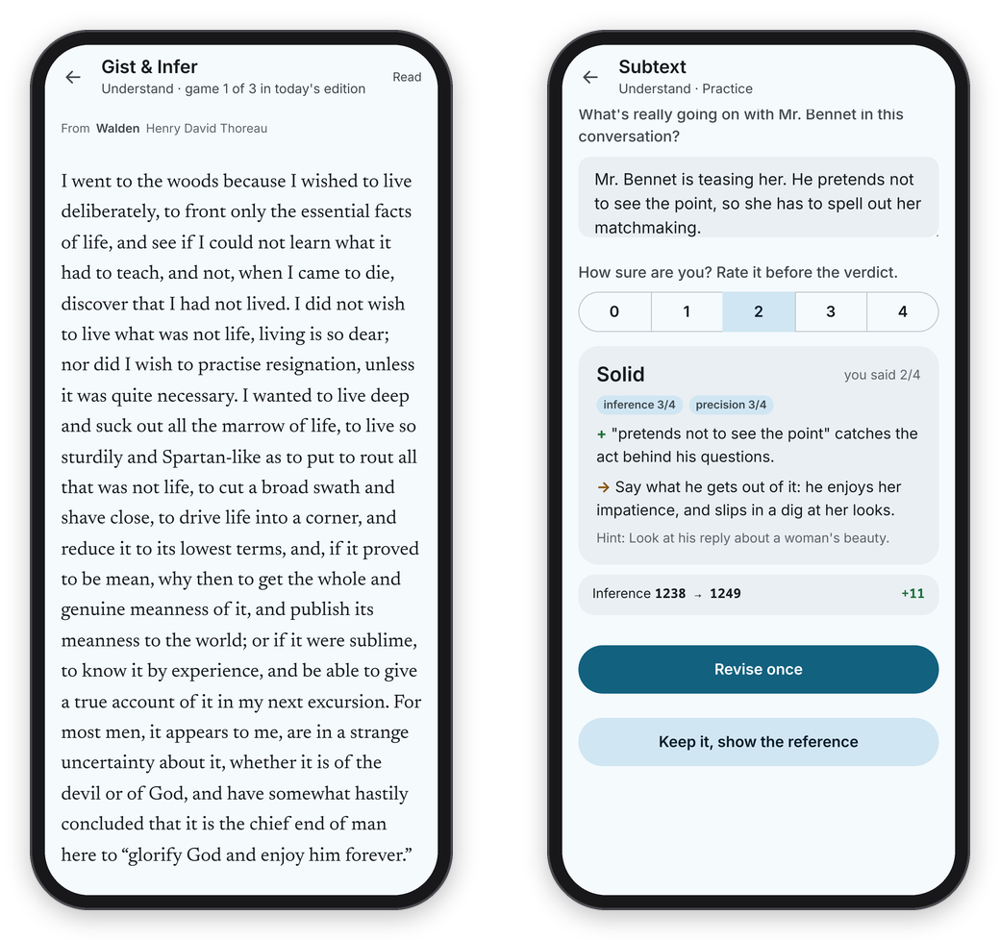
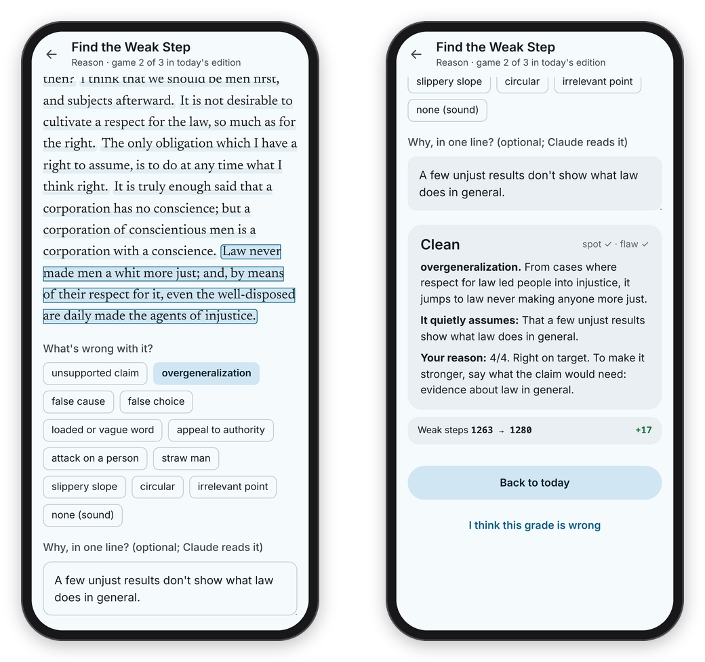
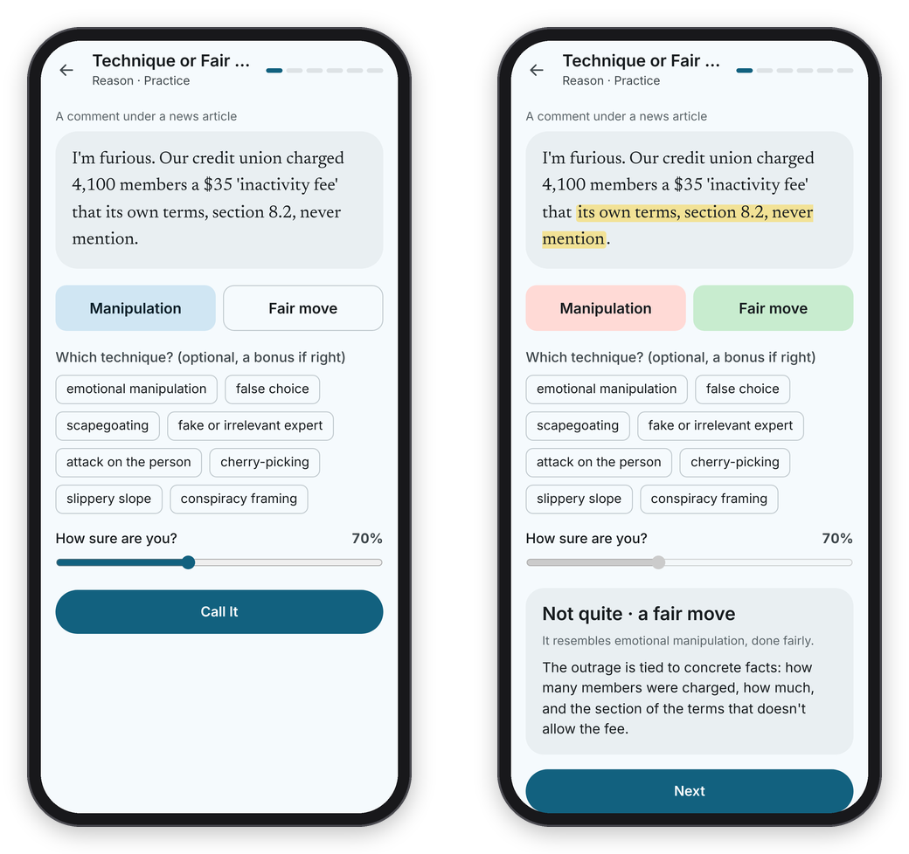
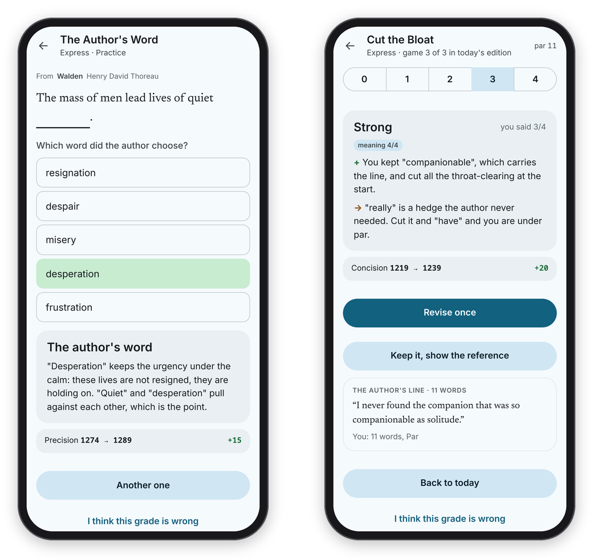

[Binah docs](README.md) › Using Binah

# The games

Binah has seven games so far, and each one is a small slice of a real skill done on real text. This page goes through them one by one: what you do, what you press, and how it's scored. They sit under three pillars, Understand, Reason and Express, plus Speak, and each game trains one skill with its own rating.

Every game has the same frame: a header with a back arrow, the game's name and where it sits ("Reason · game 2 of 3 in today's edition", or "Practice"), and on a wide computer window the games with a passage split in two, the text on the left and your answer and the verdict in a panel on the right. On a phone a game has the whole screen.

Two lanes do the scoring. Anything that can be counted is scored by code, instantly: which sentence you tapped, which word you picked, technique or fair, word counts and pauses. Claude only judges what needs judgment, like whether a gist keeps the point, and always against a hidden key. Every criterion Claude scores runs from 0 to 4 with a written description of each level, and those same descriptions are what you use when you score your own answers for the golden set.

## Where the items come from

Technique or Fair Move? and Just a Minute ship with the code: 160 calls (80 manipulative, 80 fair) and 200 topics, all written for Binah, and every call checked blind by a second model before it went in. The five reading games (Gist & Infer, Subtext, Find the Weak Step, The Author's Word and Cut the Bloat) are made by the passage engine from your own ebooks, which is why the source line on each one names one of your books. If you run Binah without a library, those five have nothing to play yet. The screenshots here use public-domain passages instead.

## Gist & Infer (Understand · Gist)

You read a passage of about 140 to 230 words at your own pace, rereading as much as you like, then press **I've got it, hide the passage**. From memory, you write its main point in 20 words or fewer ("the point, not the topic", with a counter), and answer one question whose answer is implied but never stated. Then you rate yourself and press **Send to the grader**.

Claude scores four things from 0 to 4: the main idea, accuracy, concision, and the inference. Your score is their total out of 16, and the reference shows which of its three to five key points your gist covered. This is the game with the full answer, verdict, revise, reference loop (see [The daily edition](daily-edition.md)).

*Gist & Infer starts with the passage. Subtext asks what's really going on in a scene.*

## Subtext (Understand · Inference)

A scene from a novel, mostly dialogue, and one specific question about what's really going on. You answer in a line or two, rate yourself, and send it. Claude scores the inference (70% of the score) and how precisely it's put (30%), and the reference shows the answer and the line that gives it away.

## Find the Weak Step (Reason · Weak steps)

A real argument, split into sentences. Tap the sentence where the reasoning is weakest, then pick what's wrong with it from a fixed list of everyday flaws: unsupported claim, overgeneralization, false cause, false choice, loaded or vague word, appeal to authority, attack on a person, straw man, slippery slope, circular, irrelevant point. About a quarter of the arguments should be sound, so **none (sound)** is on the list too. Press **Check Answer**.

Half the score is the spot and half is the flaw, both scored by code, so the result is instant: **Clean**, **Half right** or **Missed**, with the weakest sentence underlined, the flaw explained, and what the argument quietly assumes. If you wrote a reason in the optional line, Claude reads it and gives it a score out of 4 and one sentence of feedback, which doesn't move your rating.

*Tap the sentence, name the flaw, and say why in a line if you like.*

## Technique or Fair Move? (Reason · Fair or trick)

A round of six short texts, each with its context ("A comment under a news article", "A pet product ad"). For each, press **Manipulation** or **Fair move**, set how sure you are from 50% to 100%, and press **Call It**. A row of dots at the top right fills in as the round goes, one for each call, marking the right ones and the wrong ones. If you say manipulation, you can also name the technique for a bonus. Half of every round is manipulative and half is the same move done fairly, because a game with only tricks just teaches you to distrust everything.

After each call you see the answer, the "tell" highlighted in the text, and why. A right call on a fair move scores full marks, a right call on a trick scores 70%, and naming the technique adds the rest. At the end of the round you see how many you called right and a Brier score for how well your confidence matched, and Skills tracks your discernment over all rounds.

*This one sounds like outrage, but the facts in it warrant the feeling, so it's a fair move.*

## The Author's Word (Express · Precision)

A sentence from a good writer with one word blanked out, and four or five close candidates. Tap the one you think the author chose. It's scored right or wrong, instantly, and then you see the author's word and why it was the right one, which is the part worth reading.

## Cut the Bloat (Express · Concision)

Someone took a good writer's sentence and padded it to about 1.7 times its length. Cut it back without changing what it says. "Par" is the author's own word count, and the meter tells you where you are in golf terms: **Eagle**, **Birdie**, **Par**, **Bogey**, **Double bogey**. Rate yourself and press **Putt**.

Claude judges only whether your version keeps the original's meaning, from 0 to 4, and each word over par takes 12% off. Then the reference shows the author's line. You get one revision here too (**Putt again**).

*The author's word, and a cut that came in at par.*

## Just a Minute (Speak · Fluency)

Sixty seconds on a topic without hesitation, repetition or deviation, like the radio show. Code measures hesitation and repetition from the transcript, and Claude judges only deviation and structure. It has its own page, because there's more to how speech is measured: see [Speaking](speaking.md).

## Practice

Every game is also in **Practice**, as a card with its minutes, a line about what it is, and how many items are ready, and **All**, **Understand**, **Reason**, **Express** and **Speak** at the top narrow the cards to one pillar. Pick one for an extra round, and at the end press **Another one** (or **Another round**). Practice moves your ratings like the edition does, but it doesn't count toward the week.

Next: [Ratings and the golden set](ratings-and-golden-set.md) →
