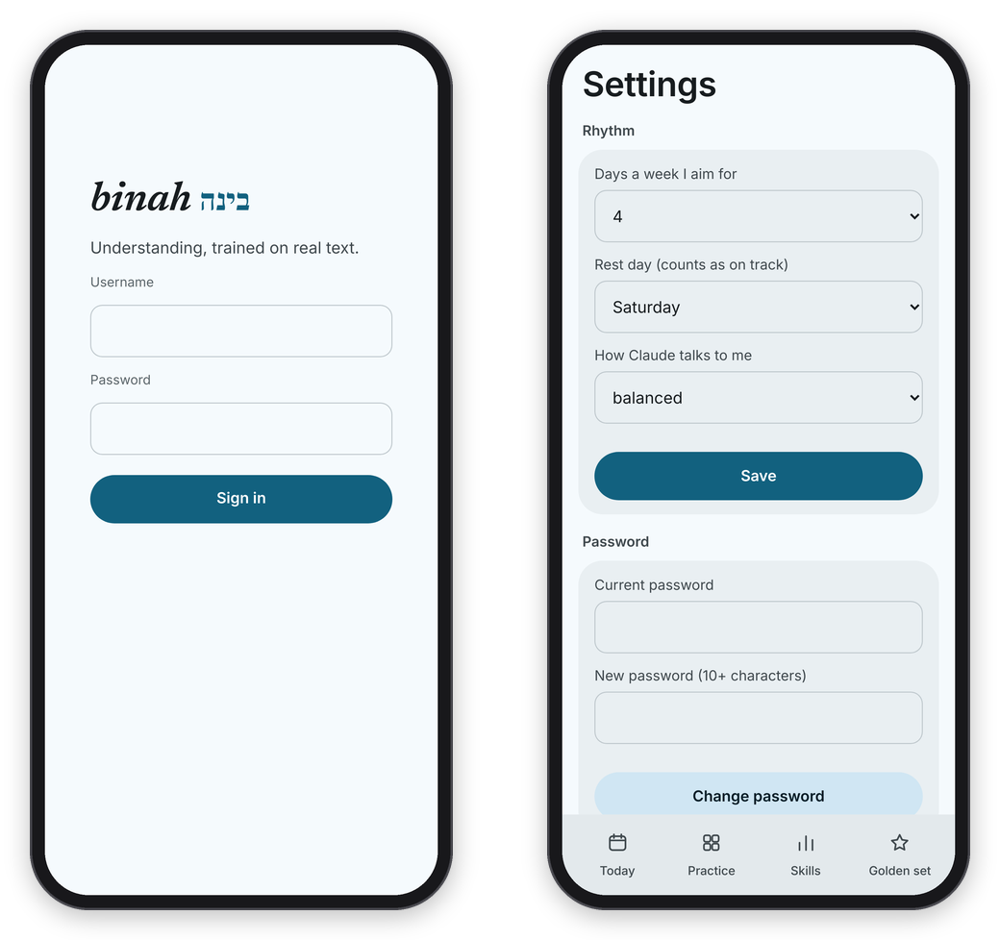

<sub>[Binah docs](README.md) › Getting started</sub>

# Install and devices

Binah is a web app first, so installing it mostly means opening your copy's address and signing in. This page walks you through that, then through building the Mac and Android apps. The Mac app is native, and the Android app adds a few things a web page can't do. You need a Binah server running first. If you don't have one yet, [Your own server](server.md) is the place to start.

My own copy is at `https://binah.tiresia.xyz`, behind a login, so it's only useful to me. Everything below assumes your own address. If you only want a taste first, one game runs in your browser with no server at all: see [Try one game first](what-is-binah.md#try-one-game-first).

## On the web

Open your copy's address in any browser and sign in with the username and password that were set on the server (`python -m binah.cli set-password`). You stay signed in on that browser for a year, unless the password changes, which signs out every browser at once.


*Sign in once per browser. Settings is where the weekly goal, the rest day and the grading tone live. On a phone it's the button at the top right of Today, and on a computer it's in the sidebar.*

On a phone, install it so it opens like an app. In Safari press the share button and then **Add to Home Screen**, and in Chrome open the menu and press **Install app** (or **Add to Home screen**). It then opens full screen, without the browser's bars.

Two things need https (or `localhost`): recording your voice for Just a Minute and the benchmark talk, and the pages Binah keeps so it opens without a connection (the games themselves always need the server). On a plain `http://` address on your home network you can play everything else.

## The Mac app

The Mac app is native, written in SwiftUI with no web page inside. It talks to your server's JSON API ([API.md](API.md)) with a device token. It has a sidebar, the games with an inspector beside the passage, today's edition in the menu bar, Train on This from any app, and the microphone for spoken answers. There are no downloads on GitHub Releases, so you build it from this repository.

You need macOS 26 or newer and Xcode (the build uses its `actool` to compile the icon):

```sh
cd mac
./build.sh                                   # makes build/Binah.app
ditto build/Binah.app /Applications/Binah.app && open /Applications/Binah.app
```

The build signs with your Apple Development identity if your keychain has one (a free personal team in Xcode is enough), and ad hoc otherwise. With an ad hoc signature, the Keychain and the microphone ask again after each new build, because the signature changed. No team or identity is written into the repository.

The app opens my copy by default, so first open **Binah → Settings…** (⌘,), go to **This Mac**, put your own address under **Binah's address**, and press **Use**. Then sign in once in the window with your username and password. The app swaps that sign-in for a device token of its own, kept in your Keychain, and **Settings → Connected devices** lists it as `mac`.

What you get:

- **The window.** A sidebar with Today, Practice and Skills, then the Golden Set and the Benchmark, with today's count and the week at its foot. A game opens on top of its room. Subtext, the Weak Step, the Author's Word and Technique put the passage on the left and your answer in an inspector on the right. Passages are set in New York.
- **The menus.** **Go** has **Today** ⌘1, **Practice** ⌘2, **Skills** ⌘3, **Golden Set** ⌘4, **Benchmark** ⌘5, **Back** ⌘[ and **Reload** ⌘R. **Binah → Settings…** (⌘,) has your rhythm and Claude's tone, your password and **Sign Out**, and this Mac's address and menu bar.
- **Today in the menu bar**: `1/3`, or `3/3 ✓` once the edition is done. Click it for the edition, Practice and Train on This. You can turn it off under **Settings → This Mac**.
- **Train on This.** **File → Train on This…** (⇧⌘T) takes a link or a passage, and offers what's on the clipboard. With text selected in any app, **Services → Train on This in Binah** sends it. The Services item appears once Binah has run from Applications. For now Binah only keeps what you send, and the nightly run doesn't turn it into items yet.
- **Just a Minute and the benchmark talk** are recorded by the app itself and sent to the server. macOS asks once for the microphone, and the Mac stays awake while you speak.
- **`binah://go/<room>`** links open a room, for Shortcuts: `binah://go/practice`, or `binah://go/settings`.

The details, and the self-test that checks all of this against a sandbox, are in [mac/README.md](../mac/README.md).

## The Android app

The Android app is Binah in a full-screen WebView, with a home-screen widget, Train on this in the share sheet, and the microphone. It's built from the repository too. You need JDK 17 and the Android SDK (platform 36), and the scripts are written for a Mac's shell (zsh), though Gradle itself runs anywhere.

```sh
cd android
./gradlew assembleDebug                       # a test build, "Binah dev", beside the real app
./release.sh                                  # the signed release, android/Binah-0.1.0.apk
adb install -r Binah-0.1.0.apk
```

`release.sh` needs a signing key of your own. Put a `keystore.properties` in `android/` with `storeFile`, `storePassword`, `keyAlias` and `keyPassword` (git ignores it, and any `*.keystore` and `*.apk`), or pass the path to one: `./release.sh /path/to/keystore.properties`.

It opens my copy by default too, so long-press the icon, open **App settings**, put your address under **Binah's address** and press **Use**, then sign in. A few seconds after you sign in, the app connects itself with a device token, kept encrypted on the phone. **Connect this phone** does the same by hand, and **Forget the token** drops it.

What you get:

- **The widget**, 2×2 or 4×2: a ring of today's games with the count, and on the wide one the next game, the minutes left and the week. Tap it for Today. If Binah can't be reached, it keeps the last numbers, dimmed.
- **Train on this** in any app's share sheet: a link, or a passage of 20 words or more. A card at the bottom says what Binah answered.
- **Long-press the icon** for Today, Practice, Skills and App settings.
- **Back** goes out of a game first, then back a page, and only leaves the app when there's nowhere left to go.
- **The microphone** for Just a Minute and the benchmark talk. Android asks once, and **Allow the microphone** in App settings asks again if you said no.

More in [android/README.md](../android/README.md), including the check that runs on a plugged-in phone.

## Devices and their tokens

The widget, the menu bar and Train on this don't use your browser's sign-in. Each device gets its own token instead, which the server stores only as a hash, and posting the same device name again replaces its old token. Changing your password signs out every browser but leaves device tokens alone, so if you lose a phone, disconnect it under **Settings → Connected devices**, which lists every app with when it connected and when it was last seen (or use `DELETE /api/devices/<name>`, see [SHELL.md](SHELL.md)).

If you get stuck on any of this, feel free to open an issue with what you tried and what happened.

<sub>Next: [The daily edition](daily-edition.md) →</sub>
