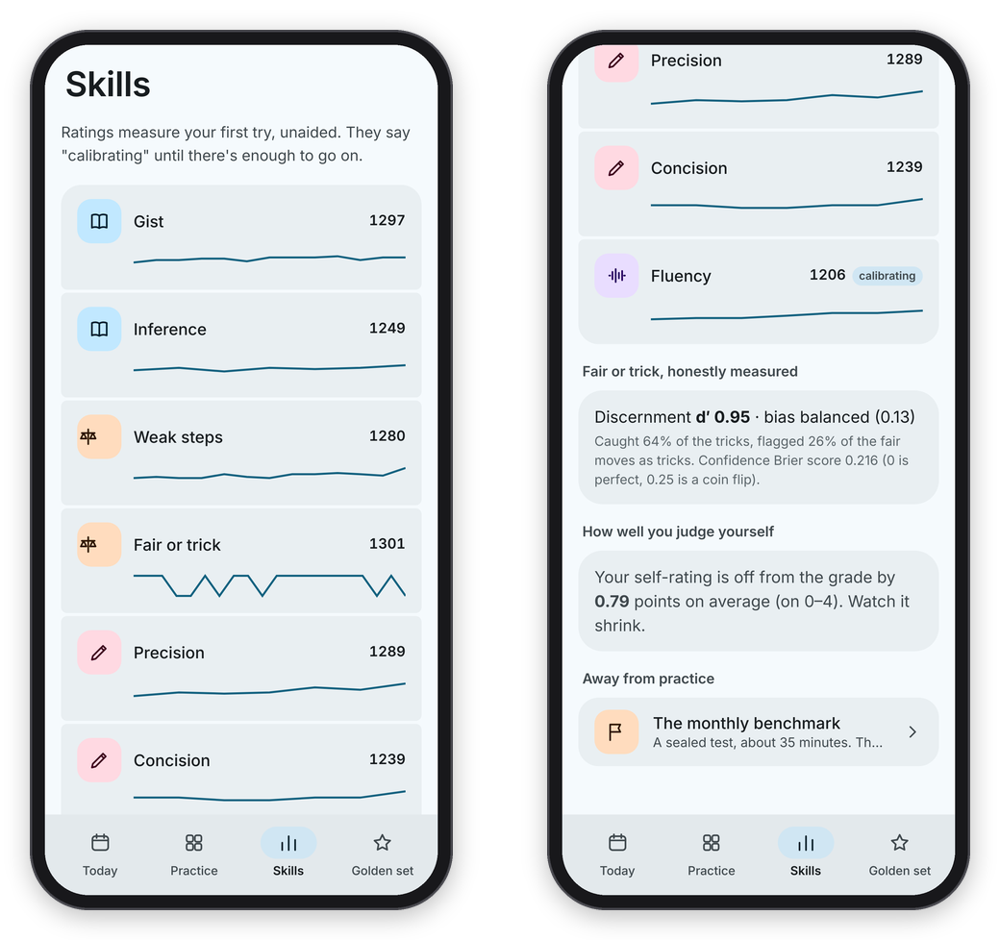
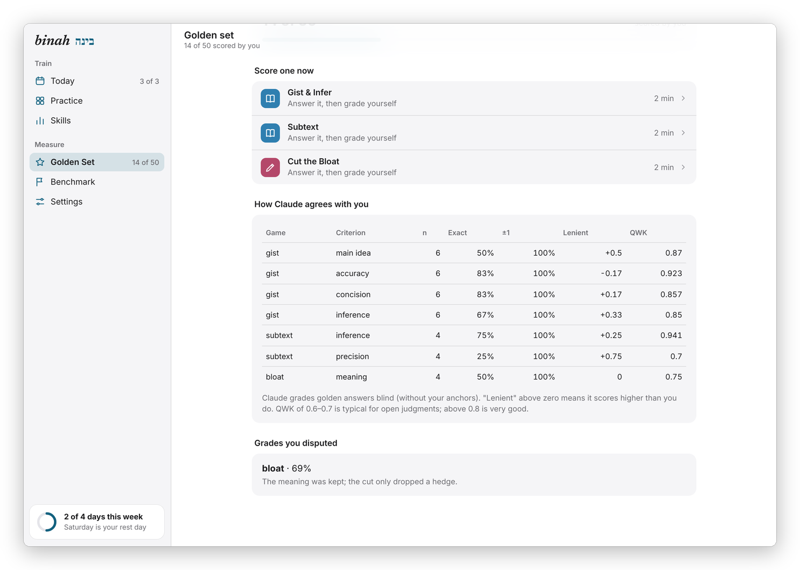

[Binah docs](README.md) › Using Binah

# Ratings and the golden set

Ratings tell you where you stand in each skill, and the golden set tells you whether to trust the grades those ratings are built on. This page explains the **Skills** screen, how a rating moves, what "calibrating" means, and how to build a golden set and read its agreement report.

## The Skills screen

**Skills** lists the seven skills under their pillars, each with its rating and a little line of your recent scores: **Gist** and **Inference** (Understand), **Weak steps** and **Fair or trick** (Reason), **Precision** and **Concision** (Express), and **Fluency** (Speak). A rating says "calibrating" until it has eight answers behind it, because before that it's mostly a guess.

*Seven ratings with their trends, then fair or trick, how well you judge yourself, and the monthly benchmark.*

Under the ratings are three more cards:

- **Fair or trick, honestly measured.** After a few rounds of Technique or Fair Move?, this shows your discernment, d′, which goes up only when you get better at telling tricks from fair moves, plus your bias (toward calling things fair, toward calling them tricks, or balanced), how many tricks you caught, how many fair moves you flagged, and a Brier score for your confidence (0 is perfect, 0.25 is a coin flip). Basically, instead of a percentage that rises when you simply get more suspicious, you get a number that only rises when your judgment does.
- **How well you judge yourself.** The average gap, on the 0 to 4 scale, between the self-rating you gave before a verdict and the grade you got. It's meant to shrink.
- **The monthly benchmark**, marked **Due** when it's time for a sitting (see [The monthly benchmark](benchmark.md)).

## How a rating moves

Each skill has an Elo-style rating, like chess, and so does every item. Every answer is a match between you and the item, scored from 0 to 1 (open answers count as partial credit). If you do better than expected, your rating goes up and the item's goes down, and the other way round if you do worse. You start at 1200.

The steps get smaller as answers pile up, so a new skill finds its level quickly and then settles: your step is 64 / (1 + 0.05 × answers so far), never below 16, and an item's is 24 / (1 + 0.05 × plays), never below 6, because one person plays each item only a few times. Only your FIRST try counts, never the revision, because the rating is there to measure what you can do unaided.

Items are picked so you'd be expected to get about 75% right, which is about 190 points below your rating, and items you haven't played come first. Items from the passage engine start from the engine's own difficulty estimate (from 800 for easy to 1600 for dense) instead of a flat number, so they need fewer plays to find their place.

## The golden set

The golden set is a set of answers you scored yourself, using the same rubric Claude uses, and it's how you find out whether Claude's grades deserve your trust. It covers the three games Claude grades in full: Gist & Infer, Subtext and Cut the Bloat. The target is 50 answers, and the page shows how far along you are.

*The agreement report, criterion by criterion, and a grade I disputed.*

To add one, open **Golden set** (in the bottom bar on a phone, or **Golden Set** in the sidebar on a computer, which also shows how many you've scored, like "14 of 50") and press a game under "Score one now". Answer it the way you normally would, then press **Now Score It Yourself**. You'll see the key, and for each criterion you pick a score from 0 to 4, with the written anchor for that score shown as you pick ("4: The point, complete"). Score it the way a strict, fair editor would, and press **Save to the golden set**. Items you use for the golden set never appear in an edition or in Practice afterwards.

In the background, Claude grades your golden answer BLIND, without seeing your scores or anyone's anchors, and the report under "How Claude agrees with you" compares the two, criterion by criterion:

- **n**: how many golden answers have both scores.
- **Exact**: how often Claude gave exactly your score.
- **±1**: how often it was within one point.
- **Lenient**: the average difference. Above zero means Claude scores higher than you do.
- **QWK**: quadratic weighted kappa, the usual measure of agreement for scores like these. For open judgments, 0.6 to 0.7 is typical and above 0.8 is very good.

Your golden answers also make grading better. For each game, up to three of them (your lowest, middle and highest scored) go into every grading prompt as anchors, so Claude can see what your scores mean. The research found that's the single biggest lever on agreement.

Grades you marked with **I think this grade is wrong** are listed at the bottom, under "Grades you disputed", so you can see where you and Claude part ways.

Next: [The monthly benchmark](benchmark.md) →
