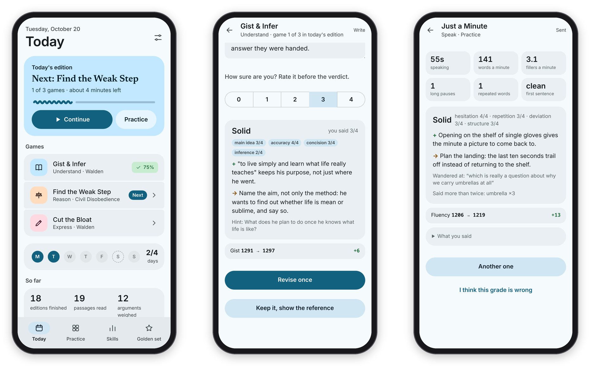
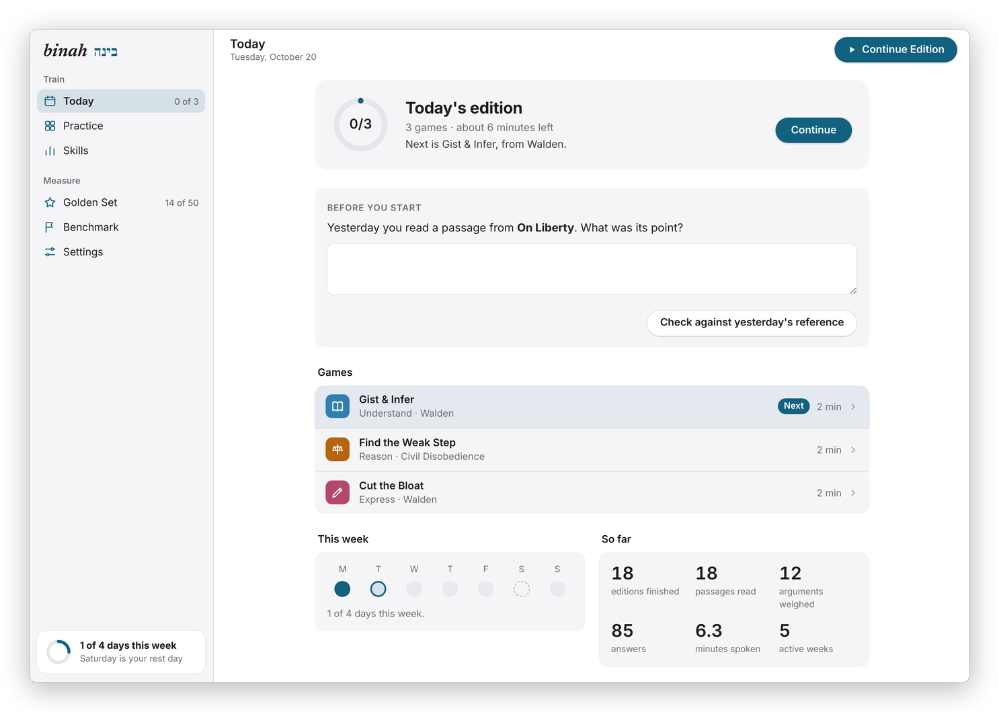

[Binah docs](README.md) › Getting started

# What is Binah?

Binah is a daily training app for three things: understanding what you read, weighing what you hear, and saying what you mean. The name is the Hebrew word for understanding (בינה). It's a web app you open on your phone or computer, with Mac and Android apps around it, and it runs on your own server, so your answers, your ratings and anything made from your own books stay with you.

*Today's edition, a verdict, and a minute of speaking.*

## What it does

Every day there's a short "edition" of about five to eight minutes: a recall card on yesterday's passage, then one game for understanding, one for reasoning, and one for writing or speaking. When those are done, the page says "Today's edition is done", and that's it for the day. There's no streak and nothing expires. You set how many days a week you aim for, and a rest day counts as on track.

The games are small, honest slices of the real skill, done on real text. In **Gist & Infer** you read a passage, hide it and write its point from memory. In **Find the Weak Step** you tap where an argument breaks. In **Cut the Bloat** you cut a padded sentence back toward what a good writer actually wrote. In **Just a Minute** you talk for sixty seconds without hesitating. There are seven games in all, and [The games](games.md) goes through each one.

Every open answer goes in the same order: you answer and rate yourself from 0 to 4, Claude reads it against a hidden key and gives one strength and one thing to work on, you get one revision, and only then do you see the reference. Anything that can be counted (where the weak step is, which word the author chose, word counts, pauses) is scored by code, instantly.

Behind the games there are three ways to keep the grading honest: a rating per skill that only measures your first try, a "golden set" of answers you score yourself so you can see how well Claude agrees with you, and a sealed monthly benchmark that never appears in practice. See [Ratings and the golden set](ratings-and-golden-set.md) and [The monthly benchmark](benchmark.md).

*On a computer, Binah looks like one of Apple's own apps, with the sections in a sidebar. On a phone it follows Material 3, with a bar at the bottom.*

The same page has two looks, and it picks one by itself. In a window 900px wide or more, and in the Mac app, it looks like Apple's own apps: a light sidebar with **Train** (Today, Practice, Skills) and **Measure** (Golden Set, Benchmark, Settings), a slim toolbar, and games split into a reading pane and an answer panel when the window is wide enough. On a phone, and always in the Android app, it follows Google's Material 3: a large title, a "Continue" card, and a bottom bar. Both have a dark mode that follows the system.

## What works where

| | Web (phone or computer) | Mac app | Android app |
|---|---|---|---|
| The daily edition, Practice, Skills, the golden set, the benchmark | yes | yes | yes |
| Just a Minute and the benchmark talk (the microphone) | yes, over https | yes | yes |
| Install it as an app | **Add to Home Screen** / **Install app** | it is one | it is one |
| Today at a glance | | in the menu bar (`1/3`, `3/3 ✓`) | a home-screen widget, 2×2 or 4×2 |
| Train on this (send a link or a passage) | | **File → Train on This…** and the Services menu | the share sheet |
| Menus and shortcuts | | the **Go** menu, ⌘1 to ⌘5, and `binah://` links | long-press the icon, and `binah://` links |
| A tap you can feel on right and wrong answers | | on a Force Touch trackpad | yes |
| The look | Material 3 under 900px wide, Apple-like with a sidebar above | Apple-like, with the Mac's sidebar material behind the sidebar | Material 3 |

The page itself is the whole app on every device, so the games, the grades and the numbers are the same everywhere. The Mac and Android apps add the few things a web page can't do on its own, and they're built from this repository (see [Install and devices](install.md)).

## What it connects to

- **The Claude Code CLI** grades the answers that need judgment and drafts the items in the passage engine. It runs on the server under the owner's own Claude subscription, with a daily cap so a bug can't use it all up.
- **faster-whisper** transcribes spoken answers on the server's own CPU. The audio never leaves your server.
- **A Calibre library** (optional) is where the reading games come from. The passage engine reads it, never writes to it, and what it makes from your books stays in your own copy. Without one, you still get Technique or Fair Move? and Just a Minute, which ship with the code.
- **A folder of Markdown files** (optional), for example in an Obsidian vault, gets one dated file a day with what you wrote, your revision and the reference.
- **A sign-in alert** (optional): any command you give it gets called when someone keeps getting the password wrong.

Basically, it's one person's training app on one person's server, which means there's one login, and apart from downloading the speech model once and the benchmark's public-domain essays, your Claude subscription is the only outside service it uses.

## Try one game first

If you'd like a taste before setting anything up, [stuffs.tiresia.xyz/binah](https://stuffs.tiresia.xyz/binah/) has Technique or Fair Move? running entirely in your browser: six calls, the tell highlighted after each one, and how you did at the end. There's no account and no server behind it, so nothing you do there leaves your browser. The full app is what the rest of these docs are about.

## Next step

If you want to try it, go on to [Install and devices](install.md). If you'd rather know why it works the way it does first, read [Why I made it](why-i-made-it.md).

Next: [Why I made it](why-i-made-it.md) →
