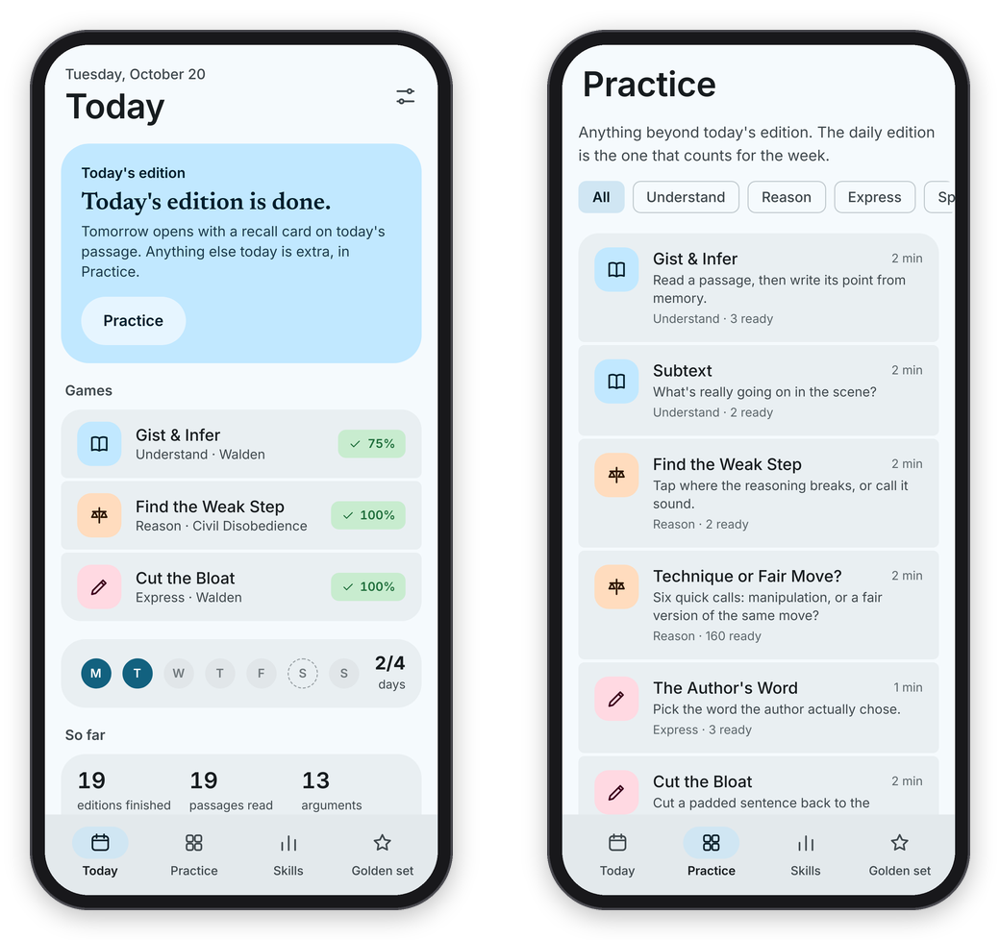

[Binah docs](README.md) › Getting started

# Why I made it

I made Binah because the skills I care about most are the ones I've never practised on purpose: getting the point of a passage, catching the step where an argument goes wrong, and saying exactly what I mean, in writing and out loud. I work with text all day, and I read a lot, but reading a lot is not the same as training. This page is the why. I've only just finished building it, so it's not yet a report on how it's going.

## What I wanted, and what the research said

I started out picturing a Lumosity for language, a few clever games a day that would make me sharper. Before building anything I read through the research on brain training, reading comprehension, critical thinking, writing feedback and speaking, and it talked me out of that. Brain games make you better at the brain games and not much else. So every game in Binah had to be a small, honest slice of the real skill, done on real text: an actual passage to summarize, an actual argument with an actual weak step, a sentence a good writer actually wrote.

The second thing the research changed was where the effort goes. The games are the easy part. What makes or breaks an app like this is whether I can trust the grades, because one wrong grade on something I worked hard at costs more than a missing game. That's why there are hidden answer keys, a blind second check on every item the engine drafts, a "golden set" of answers I score myself, and a sealed monthly benchmark. It's also why code scores everything that can be counted, and Claude only judges what needs judgment.

The third thing was the order inside an answer. Feedback on its own doesn't teach much. What teaches is using it, so in Binah I answer, rate myself, read the verdict, revise ONCE, and only then see the reference. The gap between my self-rating and the grade is tracked too, which gives me something visible to shrink.

## What I left out, on purpose

There are no streaks, no points for opening the app, no leagues and no "brain age". The research says the things that keep people coming back without wearing them out are the same things that work for me anyway: something finite, forgiving, and done in a few minutes. So the daily edition ends, nothing expires, a missed day costs nothing, and the week has a goal I set myself, with a rest day that counts as on track. The counts on the Today page only go up.

I also left out the things that sound like training and aren't: speed reading, quizzes on the Latin names of fallacies, and misinformation games where every item is fake, which only teach you to call everything fake. That last one is why Technique or Fair Move? is half manipulation and half the same move done fairly, and why it's scored as discernment, so getting more suspicious doesn't look like getting better.

And Binah makes no claim that it makes anyone smarter. It should make me better at the moves I practise, on the kinds of text I read, and the benchmark is there to tell me whether even that is true.

*The edition ends. Anything after that is extra, in Practice.*

## How I mean to use it

Here's the plan as I start. First I score answers for the golden set by hand, so I know how far to trust Claude before I lean on its grades. Then I sit the benchmark two or three times before daily use, which is the only way to see later how much of any gain is just getting used to the test. After that, the daily edition, most mornings, on my phone.

The passage engine reads my own ebooks, so the reading games are made from books I chose, and they stay in my own copy. If you run your own, the same goes for you: your books, your items, your answers, on your server. Basically, instead of one more app that wants my attention, I wanted one small thing a day that I can check is actually working.

If you want to try it, start with [Install and devices](install.md), and if something in here doesn't match what you see, feel free to open an issue.

Next: [Install and devices](install.md) →
